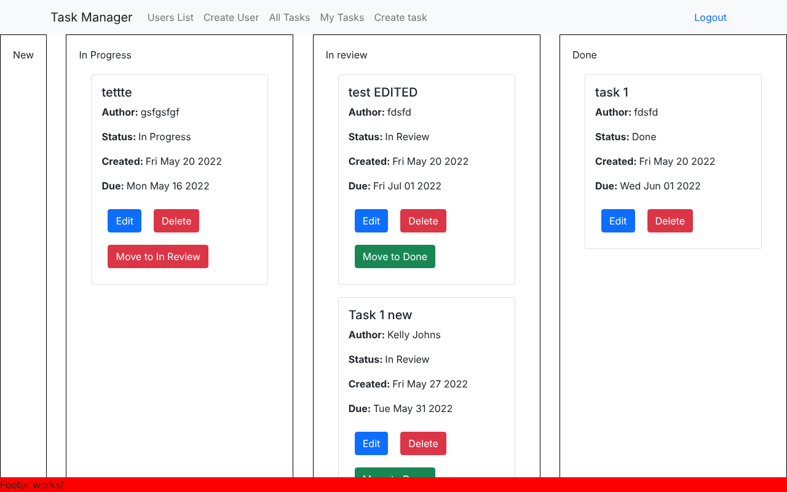
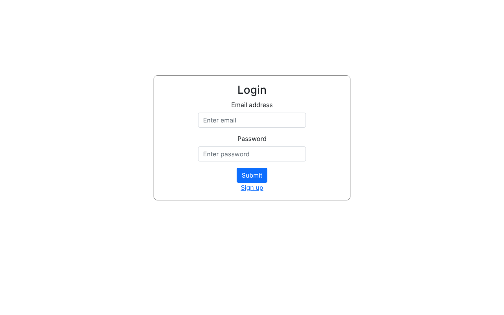
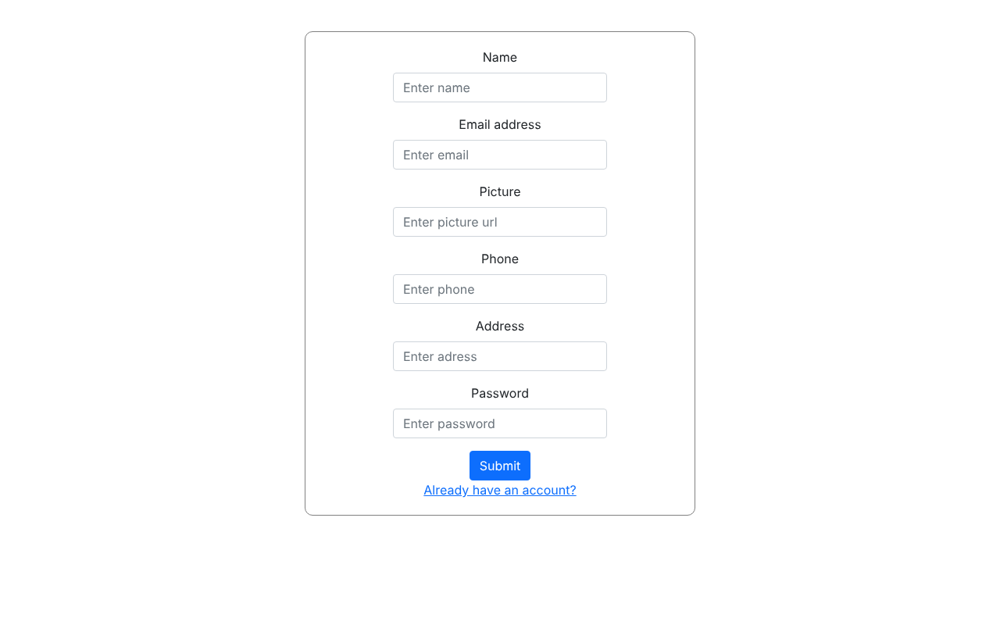
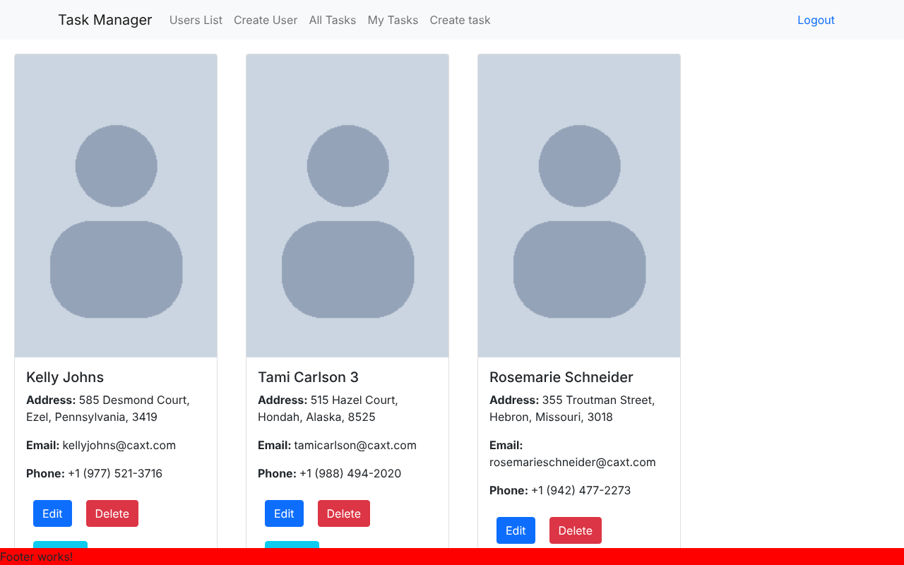
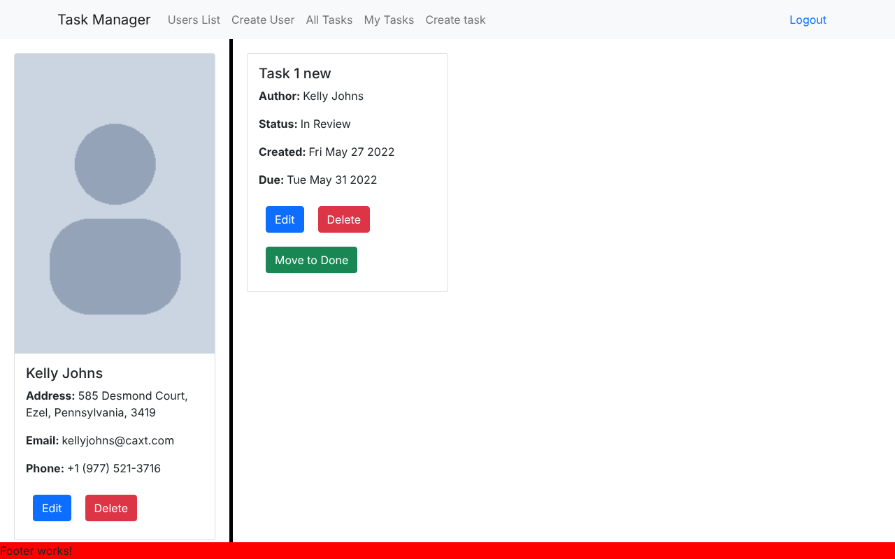
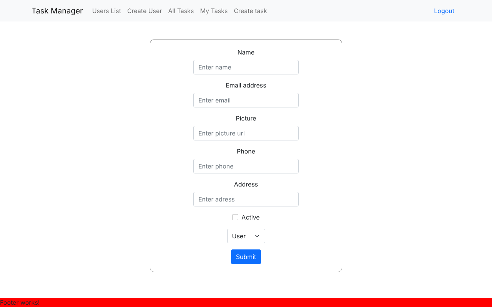
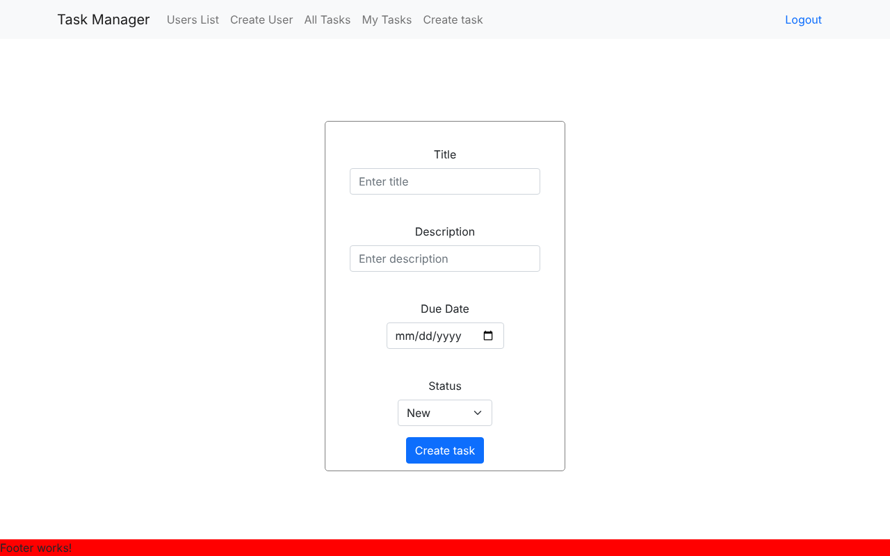

# Task Manager

A small task management app built with React. Users can log in, manage other users and create tasks that move through a simple board (New → In Progress → In Review → Done). Data is stored in a local fake REST API made with `json-server`.



## Features

- Register and log in (the logged user is kept in `localStorage`)
- Protected routes – pages are visible only after login
- Users: list, details, create, edit and delete
- Tasks: list, create, edit and delete
- Tasks board with 4 columns and **drag & drop** to change the status
- "My Tasks" page with only the tasks of the logged user
- Roles: `user` and `admin`
- Blocked users (`isActive: false`) can't log in

## Tech stack

| What | Used for |
|---|---|
| React 18 | UI (function components and hooks) |
| React Router 6 | Routing and route guards |
| React Bootstrap / Bootstrap 5 | Navbar, cards, forms, buttons |
| Axios | HTTP requests |
| Sass (SCSS) | Styles |
| json-server | Fake REST API on port 3005 |

## Getting started

You need Node.js and npm.

```bash
npm install
```

Start the API (in one terminal):

```bash
npm run start-json:server
```

Start the app (in a second terminal):

```bash
npm start
```

The app opens at http://localhost:3000 and the API runs at http://localhost:3005.

### Test accounts

| Role | Email | Password |
|---|---|---|
| Admin | `email@test.com` | `123` |
| User | `kellyjohns@caxt.com` | `123` |

## Screenshots

### Login



### Register



### Users list

Every user is shown as a card with buttons for edit, delete and details. You can't delete your own account.



### User details

Shows the user card and all tasks created by this user.



### Create / edit user

The **Active** checkbox and the **role** select are visible only for admins.



### Tasks board

Tasks are grouped by status. A task can be dragged to another column or moved with the button on the card.


### Create / edit task



## Roles and permissions

| Action | User | Admin |
|---|---|---|
| See users and tasks | ✔ | ✔ |
| Create tasks | ✔ | ✔ |
| Edit / delete a task, "Move to ..." button | only own tasks | all tasks |
| Change `Active` and `role` of a user | ✘ | ✔ |
| Delete own account | ✘ | ✘ |

## Routes

| Path | Page | Access |
|---|---|---|
| `/login` | Login | only when not logged in |
| `/register` | Register | only when not logged in |
| `/users-list` | All users | logged in |
| `/user/:id` | User details | logged in |
| `/user/create` | Create user | logged in |
| `/user/edit/:id` | Edit user | logged in |
| `/tasks-list` | All tasks | logged in |
| `/tasks/:id` | Tasks of one user (My Tasks) | logged in |
| `/task/create` | Create task | logged in |
| `/task/edit/:id` | Edit task | logged in |

The guards are in `src/utils/guards`: `AuthenticatedRoute` sends you to `/login` if you are not logged in, and `NonAuthenticatedGuard` keeps logged users away from the login and register pages.

## API (json-server)

The data is in `db/db.json`. json-server creates these endpoints automatically:

| Method | URL | Used for |
|---|---|---|
| GET | `/users` | all users (also used for login) |
| GET | `/users?email=...` | check if an email is taken |
| GET / PUT / DELETE | `/users/:id` | one user |
| POST | `/users` | create / register user |
| GET | `/tasks` | all tasks |
| GET | `/tasks?authorId=...` | tasks of one user |
| GET / PUT / DELETE | `/tasks/:id` | one task |
| POST | `/tasks` | create task |

All requests are in `src/utils/http-utils/user-requests.js` and `task-requests.js`.

## Project structure

```
db/
  db.json                 fake database
src/
  components/
    auth/                 Login, Register
    header/               navbar + logout
    footer/
    layout/               Header + page content (Outlet) + Footer
    main/
    tasks/                TasksList (board), TaskCard, TaskForm
    users/                UsersList, UserCard, User (details), UserForm
  utils/
    guards/               route guards
    http-utils/           axios requests
  App.js                  all routes
  index.js                createRoot + BrowserRouter
```

## Scripts

| Command | What it does |
|---|---|
| `npm start` | runs the app in development mode |
| `npm run start-json:server` | runs the fake API on port 3005 |
| `npm run build` | builds the app for production in `build/` |
| `npm test` | runs the tests |

## License

MIT – see [LICENSE](LICENSE).
